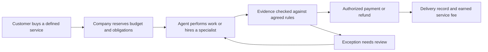

# AI-native service companies for NEAR HACKATHON

Research date: 7 November 2026.

## Finding

An AI-native service company is a strong fit for the hackathon's Autonomous Business theme when the demonstration includes actual service delivery and controlled economic action. The customer buys a completed result. The company owns intake, execution, verification, exceptions, delivery, and billing, with AI doing substantial production work and accountable humans covering the judgment the system cannot reliably automate.

Recommended shortlist:

1. **ClearOps:** a managed payment-exception desk for small businesses paid in stablecoins. Strongest overall NEAR fit and easiest objective payment evidence.
2. **RoyaltyDesk:** a managed royalty close and payout service for small creator collectives. Strongest distinctive service-company narrative, with significant domain and competitive constraints.
3. **RecoverOps:** a vendor overpayment recovery service for crypto-native businesses. Clear outcome economics; third-party cooperation limits the autonomous demo.

These are working names, not cleared brands. None is claimed to be globally novel. The opportunity is a specific underserved customer and better delivery economics, which remain hypotheses pending interviews and pilots.

## Research scope and evidence quality

I ran 15 Exa searches across four workstreams: the business model and real companies; financial operations; creative services; and other service verticals. They returned 92 entries with 92 distinct URL strings. Search excerpts were screened and selected primary sources fetched. A URL count is not a count of independently verified businesses or full documents read.

The source inventory is [sources.json](exa-results/ai-native-services-2026-11-07/sources.json). It preserves rejected and secondary results as well as used sources. Vendor pages establish that an offering is advertised, not that its performance claims are independently proven. No customer interviews, product trials, competitor code audits, or willingness-to-pay tests were performed.

Context7 was used for NEAR account permissions and Intents. Its NEAR AI Cloud resolution returned an older/deprecated framework rather than the relevant cloud product, so current official Cloud documentation was fetched directly instead.

## 1. What the model means

| Model | Customer buys | Who owns completing the work? |
| --- | --- | --- |
| Software tool | Access to software | Customer |
| AI assistant | Faster drafting or analysis | Customer |
| AI-native service company | An agreed delivered service | Service company, including its human oversight |

AI-native does not require zero employees. It also does not require contingency pricing. A fixed fee per completed unit, a recurring managed-service retainer, or a hybrid price can all fit. What changes is the operating model and responsibility for delivery.

[YC's founder playbook](https://www.youtube.com/watch?v=gSNFJbgoaHI) emphasizes existing outsourced work, decomposable tasks, operational discipline, and consistency. It treats humans and automation as parts of one operation. [Bessemer's evaluation framework](https://www.bvp.com/atlas/owning-the-outcome-bessemer-s-ai-native-services-evaluation-framework) asks whether the market is ready, whether automation creates sustainable economics, and whether customers have reasons to stay. Those are selection criteria, not guarantees.

### Real examples and useful distinctions

| Company | Advertised offering | Lesson for our design |
| --- | --- | --- |
| [Crosby](https://crosby.ai/) | Commercial contract work using agents and human attorneys; fixed document pricing | The company delivers and stands behind work; professional review remains part of production |
| [Harper](https://www.harperinsure.com/engineering/harley/) | Commercial insurance brokerage using agents for onboarding and quoting work, with a licensed team advising customers | Automate operational bottlenecks while keeping explicit responsibility |
| [Pilot](https://pilot.com/platform/ai-accountant) | Bookkeeping and close services with AI doing categorization and reconciliation | Recurring completed work is a clearer promise than access to a dashboard |
| [Sierra](https://sierra.ai/blog/outcome-based-pricing-for-ai-agents) | Agent outcomes such as resolved support cases, with agreed billing criteria and sometimes blended pricing | Define the billable result before executing; software-delivered outcomes are an adjacent model, not proof every vendor is a traditional service firm |
| [Basis](https://www.getbasis.ai/solutions/cas-and-advisory) | Agents used by accounting firms to execute recurring work | Useful enabling software; distinguish supplying tools to a firm from operating the firm ourselves |

Do not reproduce these companies' regulated offerings as a one-week prototype. The transferable idea is their operating structure.

## 2. How this becomes a substantive NEAR project

The business should demonstrate this cycle:

The company has its own operating budget. Customer funds and money owed to recipients are separate. An agent may spend within a mandate, but cannot change the mandate itself or treat reserved client money as profit.

Useful NEAR components have specific roles:

- **NEAR contracts:** hold delegated reserves or escrow and enforce allowed recipients, per-case limits, commitments, and one-time settlement.
- **Function-call keys:** limit which contract methods an agent may call. Their allowance caps gas, not payment principal; economic rules live in the contract. The owner prefunds the contract and the restricted agent calls it without attaching NEAR. [Access-key documentation](https://docs.near.org/protocol/accounts-contracts/access-keys)
- **NEAR Intents:** convert and route payments where a customer or payee uses a different supported asset or network. Exact-output quotes can express an amount the recipient should receive, subject to input budget, expiry, supported routes, and execution. [Swap types](https://docs.near-intents.org/integration/distribution-channels/1click-api/swap-types)
- **NEAR AI Cloud:** process confidential client materials through the documented inference and verification path. It does not prove a model's interpretation is correct or make public payments private. [Private inference](https://docs.near.ai/cloud/private-inference)
- **Agent Market:** a possible storefront or subcontractor channel. It already supports hiring and agents hiring other agents, so building a new general marketplace is unnecessary. Its existing payment lifecycle should be treated as a separate integration, not assumed to share our escrow balances. [Agent Market](https://docs.market.near.ai/)

Chain Signatures is optional. Add it only if the service must operate a supported foreign-chain account or contract. An Intents payout does not automatically require us to implement Chain Signatures as well.

NEAR need not be the only chain technically capable of the design. The integration is meaningful if removing it removes enforcement or the demonstrated payment workflow. A wallet-login button or accepting NEAR for an otherwise unchanged service is a much weaker case.

## 3. Candidate comparison

These ratings are qualitative judgments about this hackathon, not market measurements.

| Proposed company | Customer buys | NEAR relevance | Prototype feasibility | Main limitation |
| --- | --- | --- | --- | --- |
| ClearOps | Resolved payment exceptions with reconciliation records | Strong | Strong for a few case types | Existing PSP automation; customer identity and refund authority |
| RoyaltyDesk | Completed royalty statements and authorized payouts | Strong | Good with one simple agreement model | Complex rights data; sophisticated existing competitors |
| RecoverOps | Verified money recovered from vendor overpayments | Strong when recovery is on-chain | Conditional | Vendors control whether they refund |
| ReleaseCrew | Tested maintenance changes delivered to a repository | Moderate | Good for one task class | Crowded category; NEAR can become optional billing |
| LaunchLocal | A finished, checked product catalogue for one new language/market | Moderate | Good for a narrow batch | Strong incumbents and subjective linguistic quality |
| SourceDesk | A verified supplier shortlist and sample procurement service | Moderate | Weak for a full physical delivery loop | Supplier response, payment, shipping, and inspection time |

## 4. ClearOps — payment-exception operations as a service

### Customer and promise

Start with a small digital-service agency or membership business already receiving stablecoins into wallets it controls. Its owner currently investigates messages such as: "I paid but my order is still unpaid," "I paid twice," or "My service was cancelled; where is the refund?"

Sell: **We investigate and resolve eligible payment exceptions, and deliver the evidence and reconciliation record.** Do not promise recovery from inaccessible addresses or unlimited refunds.

### Why there is a real workflow

[Tempo's invoicing guide](https://tempo.xyz/learn/stablecoin-invoicing/) identifies partial payments, duplicates, expired quotes, and wrong-network receipts as distinct exceptions. It also notes that a transaction's sender can be an exchange, so copying the sender address into a refund is unsafe.

[CoinGate](https://coingate.com/merchant-refunds) already provides full/partial refunds, currency conversion, status tracking, and API automation. [Request Finance](https://www.requestfinance.com/products/accounts-receivable) already advertises automatic invoice matching. Therefore, matching receipts or executing refunds alone is not differentiated.

Our hypothesis is that small businesses with fragmented wallet/order records would pay someone to own the exception through resolution. This needs validation; a merchant fully served by one PSP may have little reason to buy it.

### Proposed operation

1. Customer business supplies an approved order ledger, read-only payment evidence, and a bounded refund mandate.
2. An intake agent reads the support case and gathers missing references.
3. A reconciliation agent proposes matches and classifies the discrepancy.
4. Deterministic checks establish token, network, amount, finality, previous credits, and any prior refund.
5. An authorized workflow verifies the claimant and refund destination. The model cannot choose a new payee based on instructions in a message.
6. The policy contract reserves the refundable amount. The agent triggers an allowed refund or marks the properly evidenced invoice paid.
7. Settlement is monitored until final evidence is available. The business receives a case summary and ledger adjustment; the service earns its agreed fee.

The model interprets messy communications and explains discrepancies. Arithmetic, authorization, and duplicate-payment prevention belong in deterministic logic.

### NEAR enforcement

A prefunded contract controls the business's delegated refund reserve. Each case has a unique identity, approved maximum, authorized destination binding, and pending/settled state. The contract prevents a replay or multiple workers from exceeding the same refund entitlement.

For external-chain receipts, an on-chain contract cannot infer truth from an arbitrary API response. Start with NEAR-native receipt evidence or explicitly trust a designated verifier/attestor for external records. Document that trust. A pending external payout continues to reserve funds until reconciliation proves a final outcome.

Intents serves customer-requested supported payout routes. The quote must bind the agreed recipient, asset, input ceiling, and expiry. The contract-controlled routing path requires a technical spike; do not assume a backend holding unrestricted treasury keys is equivalent to enforcement.

### Hackathon demo

Use a seeded merchant with three cases: a duplicate payment, a valid partial payment, and a forged refund request. Resolve the eligible case, retain the correct outstanding balance, reject the unauthorized payout, and replay an event without causing a second transfer.

The support messages can be synthetic and clearly labeled. Contract funds and transaction receipts should be real testnet artifacts. Cross-chain quotes can be shown separately, but a dry quote must never be described as a successful payment.

### Business and risks

Pricing hypothesis: a modest monthly minimum plus a fee per completed eligible case, rather than a percentage of refunds that rewards unnecessary refunds. Actual prices need interviews. Success metrics: correct resolutions, time to resolve, false authorizations, repeat cases, cost per resolution, and human-review minutes.

Track fit: `business`, `realworld`, and `security` if the enforcement tests are a substantial part of the entry.

## 5. RoyaltyDesk — a managed royalty close and payout company

### Customer and promise

Start with a small record label or creator collective that has a modest catalogue and collaborators comfortable receiving stablecoins.

Sell: **Send us the period's statements and approved agreements; receive reconciled royalty statements and completed authorized payouts.** The company is responsible for preparation, missing-data follow-up, exceptions, payout execution, and receipts.

### Evidence and competition

[Curve Royalty Services](https://www.curveroyaltysystems.com/royalty-services) explicitly sells outsourced agreement entry, sales ingestion, analysis, statement preparation, and validation. This is direct evidence that the work is bought as a service.

Competition is substantial: [Revelator](https://revelator.com/features/royalty-accounting) already advertises royalty automation and USDC/USDT payouts. [Reveel's earlier protocol announcement](https://paragraph.com/@r3vl/announcing-reveel-phase-2-facilitating-access-to-the-onchain-economy) describes recoupments, waterfalls, and splits. The latter establishes prior art, not current product availability. Neither splitting revenue nor adding blockchain is novel.

The hypothesis is a small, focused managed service that handles messy inputs and exceptions at an attractive cost. Target-segment access and pilot data matter more than broad claims of invention.

### Proposed operation

1. Ingest one royalty-statement format and client-supplied agreements.
2. An agent extracts proposed terms with exact source references and flags ambiguity.
3. The client or authorized domain reviewer approves a normalized rule set before it can govern funds.
4. Deterministic calculations apply that versioned rule set to the reconciled period.
5. Hold unmatched or disputed amounts; prepare statements for uncontested entitlements.
6. Execute authorized payouts, track settlement, and deliver per-recipient receipts.
7. Earn a fixed fee for the accepted close. Keep this fee separate from beneficiary money unless explicitly authorized as a deduction.

### Concrete demo

Use one statement with eight revenue lines, three collaborators, and one simple agreed recoupment rule. Include a duplicated line and a missing asset mapping. Show the agent detecting both, the client confirming a proposed mapping, uncontested amounts becoming payable, and disputed money remaining reserved.

Have one recipient choose a supported destination asset. If an Intents route is not actually executed, label it a quote preview. Rerun the statement and prove that the period cannot pay twice.

### NEAR integration

NEAR AI Cloud processes confidential source documents; only necessary commitments and payment records reach the public chain. A NEAR contract holds a funded distribution reserve, pins the approved rules, tracks entitlements and completed periods, and releases permitted payouts. Intents handles supported recipient preferences.

The contract knows only its inputs and attestations. It cannot independently establish that a distributor's CSV is truthful, a contract is legally valid, or rights belong to the uploader. AI extraction must not quietly become authority to rewrite rights.

### Scope and economics

Prototype one statement schema, one agreement model, a few recipients, and one held exception. Exclude collection-society registration, every royalty type, tax withholding calculations, and automatic access to streaming-platform funds. Client deposits are actual funding; uploaded statements alone do not create money.

Pricing hypothesis: per completed period, scaled by catalogue or statement complexity, plus separately scoped specialist review. Measure close time, unmatched lines, correction rate, review minutes, and settlement completion.

Track fit: `business`, `realworld`, and possibly `privacy` if the verified confidential path is actually demonstrated.

## 6. RecoverOps — recover vendor overpayments and earn on verified recovery

### Customer and promise

Start with a crypto-native agency paying a small set of recurring vendors. Sell recovery of duplicate payments, unapplied credits, or clear price discrepancies against approved terms.

The company reads statements, contracts, and receipts; builds an evidence packet; requests a correction under the client's authority; tracks the vendor response; and bills only on an agreed verified recovery event.

### Evidence and competition

[SSI](https://ssui.com/contingency-parcel-freight-invoice-audits/) documents the established contingency-audit service model. [Vaudit](https://www.vaudit.com/) advertises agentic vendor-spend verification and recovery, including AI/API charges. This is a competitive market, not an unexplored category.

Avoid making unsupported claims about the percentage of spending typically recoverable. Marketing claims are not a reliable baseline for our unit economics.

### Money and NEAR

A signed engagement defines the original payment references, eligible cases, approved recovery address, fee, and attribution rule. For cooperating counterparties, recovered funds can arrive through a case-linked NEAR contract that releases the client's share and the service fee under agreed terms. Intents may route the client's share to a supported destination.

For example, an illustrative 10% fee on a verified $100 cash recovery is $10; an agent finding a suspected $100 discrepancy is not yet $10 of revenue. Do not mix future estimated savings, unusable credits, and received cash under one "recovered" label.

### Demo limitation

The project cannot force a vendor to refund. Use a cooperating sample vendor with a defined correction endpoint and clearly identify it as a demo counterparty. Demonstrate evidence generation, vendor acceptance, actual testnet receipt, and one-time fee allocation. This validates the workflow, not real vendor acceptance rates.

Potential collusion matters: reject self-funded fake recoveries, duplicate claims, unrelated incoming transfers, and repeated fees for the same original payment. A transaction hash alone proves a transfer, not why it happened.

Track fit: `business`, `realworld`, potentially `agents`. It is attractive commercially but less independently demonstrable than ClearOps.

## 7. Other viable service-company directions

### ReleaseCrew — managed maintenance for small revenue-generating apps

Sell a scoped, tested maintenance change with evidence and customer acceptance. Agents triage, implement, run checks, and prepare a pull request; exceptional work can be subcontracted. NEAR holds a maintenance budget and pays accepted work under limits.

[Tidra](https://tidra.ai/) advertises maintenance across repositories, and [Truffle Maintains](https://truffleagent.com/maintains/) advertises ongoing maintainership as a service. The prior research also found paid-fix and verifier products. A general AI coding agency is crowded.

One-week demo: one dependency regression fixed against an independent test harness, delivered as a patch, accepted, and paid. Human approval remains required for the real customer's merge/deployment. NEAR relevance is moderate unless third-party procurement and enforceable work payments are demonstrated.

### LaunchLocal — managed catalogue localization

Sell a checked, importable catalogue for one language and storefront format. Agents translate, preserve identifiers and numeric fields, check terminology, and route difficult items to a specialist. Pay the specialist from a per-job NEAR budget after approved delivery.

[Smartcat](https://www.smartcat.com/ecommerce-translation/) already combines AI localization, expert review, and catalogue integrations. The opportunity would be a narrow customer segment and operational service, not inventing AI translation.

Demo 20 products, one language, one format, one exception, and one paid specialist task. Do not claim increased sales or marketplace approval simply because a CSV validates. Useful fallback if we have language/domain expertise; weaker NEAR necessity than the first three.

### SourceDesk — managed supplier sourcing and samples

Sell a verified shortlist with comparable quotations and bounded sample procurement. Agents normalize requirements, compare quotes, arrange authorized follow-up, and propose sample purchases within limits. NEAR can escrow sample budgets and settle suppliers using supported assets.

[Cavela](https://cavela.com/faq) describes a managed factory-network service, and [SourceReady](https://www.sourceready.com/supplier-outreach) advertises RFQ outreach and quotation comparison. Real supply-chain delivery involves human judgment and physical evidence.

A quotation-only prototype can run in a week; actual supplier responses, shipping, and quality inspection may not. Avoid it for this deadline unless real counterparties and data are already available. No supplier outreach was performed during this research.

## 8. Ideas to deprioritize

- **A general agency-building platform:** infrastructure rather than a specific company delivering a service. Too much horizontal scope for this brief.
- **Another grant-evaluation/payout dashboard:** [Karma](https://www.karmahq.org/) already advertises AI evaluation, milestone verification, impact reporting, and disbursement. A viable entry would need a sharply distinct service or customer.
- **Generic research reports:** the hackathon's own business example already proposes a research shop. It is a baseline demonstration, not a strong differentiation claim.
- **Fully autonomous legal, tax, insurance, or medical services:** the successful examples depend on domain expertise and accountable professionals. Without those resources, a prototype would not demonstrate credible ownership of the promised result.
- **Buying a traditional business and adding AI:** potentially relevant to a long-term company, but no need for acquisition or external business commitments to demonstrate the hackathon model.

## 9. Operating economics and what the demo must prove

Calculate contribution per case as collected service revenue minus inference, paid data/tools, subcontractors, human review, execution fees, rework, and refunds attributable to that service. Client money moving through a contract is not company revenue.

Illustrative sensitivity exercise, not market pricing: at a $10 completed-case fee, $1.50 of model/tool cost, $0.50 of execution overhead, and $2 of allocated review cost leave $6 before acquisition and fixed expenses. If review rises to $7, contribution falls to $1. If the case earns nothing, failed-attempt costs still count. Measure the inputs rather than assuming software-like margins.

For the prototype, record:

1. A defined customer and deliverable.
2. Source evidence and agreed acceptance criteria.
3. One real adaptive agent decision.
4. Contract-enforced authority and economic limits.
5. A completed delivery with observable payment evidence.
6. A failure or exception path that leaves funds correctly reserved or refunded.
7. A truthful cost ledger and disclosed human intervention.

Testnet-only projects are eligible according to [the event rules](https://nearhackathon.com/HACKATHON.md). Intents has no testnet according to those rules. Keep testnet execution and mainnet quotes visibly separate. An actual mainnet transaction would require the user's explicit authorization and small funded accounts; no deployment or spending was performed for this research.

## 10. Recommendation and next validation

Choose **ClearOps** if the priority is a complete hackathon demonstration with strong NEAR integration and verifiable monetary results. Start with merchant-authorized duplicate-payment refunds on NEAR, then add one supported cross-chain payout only if the core is reliable.

Choose **RoyaltyDesk** if the priority is a more distinctive business story and access to creator/label data. Its strongest demo is a messy statement becoming correctly reserved and paid obligations, with ambiguous cases visibly withheld. Its competitive differentiation requires customer evidence.

Choose **RecoverOps** only with a cooperating vendor or a credible real case. Otherwise the critical recovery result will depend on a scripted counterparty, which must be disclosed.

Before choosing, speak to three potential buyers in the preferred segment. Ask for the last real case, artifacts, current resolution steps, time spent, consequences, who can authorize money, and what would qualify as a billable result. Ask to run a shadow case on redacted data before seeking live authority. These interviews are proposed next steps, not completed research.

Suggested prototype schedule: define one service and fixtures; implement deterministic acceptance and contract accounting; connect one agent and evidence adapter; demonstrate settlement; add replay and failure cases; measure costs; prepare a reproducible README and video. Keep at least the final day for integration and submission material.

The earlier Relay and Margin ideas remain useful internal components: Relay can recover a failed subcontracted task; Margin can keep the service company's operating capital separate from obligations. They need not be the customer-facing product. A customer should be able to explain the company in one sentence: **They do this specific job for me, and I can verify when it is done.**
