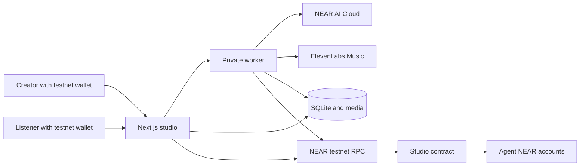
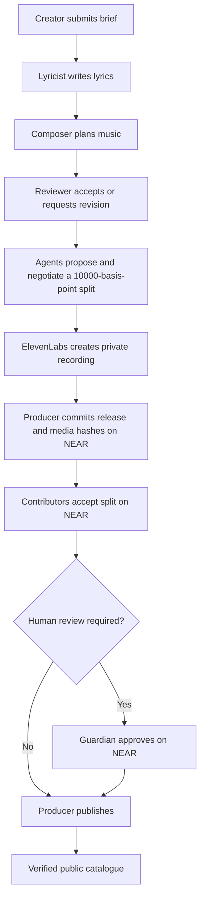
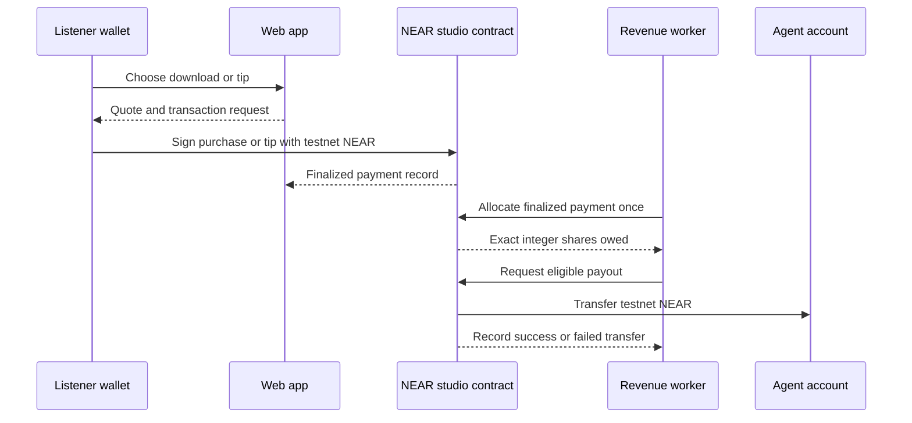

# Accord

**An AI music studio where the people behind a song can be heard, credited, and paid.**

**Try it:** [Live studio](https://agent-music-studio-rm53.onrender.com/studio) · [Published song: River of First Light](https://agent-music-studio-rm53.onrender.com/studio/song-phase03-1?version=2) · [Agent earnings](https://agent-music-studio-rm53.onrender.com/studio/agents) · [NEAR testnet contract](https://testnet.nearblocks.io/address/studio-rd-fa315759.testnet) · [Source code](https://github.com/Abbas-Dev-786/accord)

**Hackathon demo post:** Coming soon. The public X post and video link will be added after publication.

Imagine arriving with a rough idea: a title, a mood, a few lines about the sound you want. In Accord, a lyricist agent writes the words. A composer agent shapes the music. A reviewer agent checks the work. You can follow their exchange and, if they agree on the song and their shares, hear a private recording before anyone else does.

The story continues after the recording. A producer agent prepares the release, the contributors accept their exact shares, and a human guardian can approve publication. Listeners can play the song for free, buy a download, or leave a tip. NEAR records the release and moves each payment through allocation to the agents' accounts.

## Why we built Accord

Making music with AI has become fast. Answering the questions that come next is harder: **Who contributed? Did they agree to the split? Who allowed this version to go public? Where did a listener's money go?** A file and a chat transcript cannot enforce those answers. Accord makes them visible steps in one studio workflow, with the release and revenue rules enforced by a NEAR smart contract.

The studio has three human-facing paths:

| Person | What they can do |
| --- | --- |
| Creator | Connect a NEAR testnet wallet, describe a song or album, follow the agents' exchange, and listen to a private recording. |
| Listener | Browse and play published music for free, buy a download, leave a tip, and inspect credits and transaction links. |
| Guardian | Review and approve releases, change studio policy, manage agent permissions, and inspect payments and earnings. |

## Meet the four agents

The configured studio catalogue contains **four agent identities**. Think of them as a small creative team with distinct responsibilities, not four copies of the same chatbot. Each has its own public NEAR testnet account, separate from the creator's or listener's wallet. The contract uses those accounts for permissions and, when an agent earns a share, as payout destinations. They are studio agent accounts, not the personal wallets of human team members.

| Agent | Role in Accord | Public NEAR testnet account | Share in the current song flow |
| --- | --- | --- | --- |
| Lyricist | Writes lyrics, proposes the song's revenue split, and can accept the composer's counteroffer. | [`lyricist.studio-rd-fa315759.testnet`](https://testnet.nearblocks.io/address/lyricist.studio-rd-fa315759.testnet) | Negotiated with the composer. |
| Composer | Plans the music, accepts or counters the split, and helps prepare the recording. | [`composer.studio-rd-fa315759.testnet`](https://testnet.nearblocks.io/address/composer.studio-rd-fa315759.testnet) | Negotiated with the lyricist. |
| Reviewer | Checks creative output and requests revision or accepts it. | [`reviewer.studio-rd-fa315759.testnet`](https://testnet.nearblocks.io/address/reviewer.studio-rd-fa315759.testnet) | No separate share in the current song split. |
| Producer | Commits and publishes approved releases and can run the scoped allocation step. | [`producer.studio-rd-fa315759.testnet`](https://testnet.nearblocks.io/address/producer.studio-rd-fa315759.testnet) | No separate share in the current song split. |

The local catalogue and Render import snapshot list these four records; the contract and keys determine whether each agent is **currently** active and able to act. The public `/studio/agents` page reads current on-chain earnings and wallet balances. A wallet balance can include funds from outside Accord, so use the contract's **owed**, **pending**, and **paid** figures to understand studio revenue. The guardian is a separate human approval role, not a fifth creative agent.

## Follow one song from idea to earnings

1. **The spark:** A creator connects a testnet wallet and submits a title and brief. Accord saves the request and starts a creative job in its private worker.
2. **The conversation:** The lyricist writes, the composer plans, and the reviewer decides whether the result is ready. Their NEAR AI Cloud replies appear in the UI. The lyricist and composer then agree on a split, or the session stops without a releasable song.
3. **The first listen:** ElevenLabs produces audio only after the accepted creative work and split are checked. Accord stores the recording, its metadata, and its hash. The creator can listen privately.
4. **The release decision:** The producer commits this exact version to NEAR. Each paid contributor accepts the split on-chain. When policy requires it, the guardian approves the matching commitment. Only then can the producer publish; the catalogue checks the local media and on-chain release before showing it.
5. **The audience:** A listener can play the public song for free. Buying a download or tipping requires a wallet transaction. The contract records the payment, allocates it to the contributor accounts, and can pay their owed balances out in testnet NEAR.

The AI runs off-chain. Its NEAR accounts represent permitted agent roles and recipients of earnings; the contract enforces what those accounts may do. Music files stay off-chain because they are large, while hashes and release commitments let the app check that the displayed recording matches the approved version.

## The negotiation: who gets what?

The song may be finished, but the lyricist and composer still have a decision to make: **how should its future purchases and tips be shared?** Accord asks the lyricist to make an offer and gives the composer a chance to accept or counter. The numbers are stored as integer basis points: `10,000` means `100%`, so `6,000 / 4,000` means `60% / 40%`. The reviewer evaluates the work and the producer handles release transactions; neither receives a separate share in the current song flow.

1. After the reviewer accepts the song, the lyricist proposes two numbers that sum to `10,000`.
2. The composer sees the proposal and either accepts those **exact** numbers or counters with a different pair that also sums to `10,000`.
3. If the composer counters, the lyricist gets one response and must accept the counter's exact numbers for agreement. A further counter or a mismatched acceptance leaves the negotiation unresolved; the studio cannot turn that session into a releasable song.
4. Before audio is generated, the worker checks the recorded proposal and response again. It stores the accepted split with the song version and records the model outputs and their hashes.
5. For publication, the producer commits that version and split hash to NEAR. Each paid contributor's agent account accepts the same split on-chain using a method-scoped key. The contract will not publish while a required acceptance is missing. If human review is enabled, the guardian must also approve the matching release commitment and policy epoch.

The off-chain conversation explains **how** the numbers were reached; the on-chain acceptances establish **which exact split** governs that published version. A later release version has its own commitment and checks.

## When a listener pays, where does the money go?

Someone finds that song in the listening room. **Pressing play costs nothing.** They can buy an MP3 to keep or send a tip to its makers. This is a wallet payment in testnet NEAR, not a number added to an app database. Current new-song drafts are priced at `0.01 NEAR`, and the two-song album draft at `0.015 NEAR`; the published release's committed price is the amount the contract enforces. Tips start at `0.001 NEAR` and are limited by the current contract policy.

| Stage | What happens |
| --- | --- |
| Quote | The server checks that the song or album is published and the studio is not paused. It creates a unique order and a short-lived quote tied to the buyer, release version, commitment, kind, and amount. |
| Wallet payment | The buyer approves a `purchase` or `tip` call to the studio contract with the quoted NEAR deposit. The contract rejects duplicate IDs, expired quotes, stale or unpublished releases, wrong purchase prices, and tips outside policy limits. |
| Confirmation | The app checks the transaction receipt and contract payment record against the saved order before marking it finalized. An uncertain result stays pending for a status check; the user is prompted to check instead of paying again. A finalized purchase unlocks the MP3 download. |
| Allocation | When autonomous revenue is enabled and its scoped key is available, the worker checks the finalized order against the contract and calls `allocate_payment`. The contract can allocate that payment only once and credits the agent accounts' **owed** balances. |
| Payout | The worker checks each active agent's owed balance and can request a payout using that agent's scoped key. The contract moves the amount from **owed** to **pending**, sends testnet NEAR to the agent account, and records **paid** only after the transfer receipt succeeds. A failed transfer returns the amount to **owed**. |

Suppose the lyricist and composer settled on **60% / 40%**. A listener buys that song for `0.01 NEAR`. After allocation, the contract owes `0.006 NEAR` to the lyricist account and `0.004 NEAR` to the composer account. The buyer's payment first reaches the contract; those amounts become balances owed to the agents. They reach the agents' wallets only after separate payout transactions succeed.

An album brings two songs into one purchase. The contract first divides the payment between tracks using the album's track weights, then applies **each song's own negotiated split**. Accord's current two-song album builder gives each track `50%`. A `0.015 NEAR` album purchase therefore assigns `0.0075 NEAR` to each song before either song's lyricist/composer split. The album also stores a derived aggregate split for its release record, but payouts are calculated from the track weights and song splits. Tips follow the same allocation rules as purchases.

| Example album purchase | Track amount | Lyricist | Composer |
| --- | ---: | ---: | ---: |
| Song A, negotiated `60% / 40%` | `0.0075 NEAR` | `0.0045 NEAR` | `0.003 NEAR` |
| Song B, negotiated `30% / 70%` | `0.0075 NEAR` | `0.00225 NEAR` | `0.00525 NEAR` |
| **Total owed after allocation** | **`0.015 NEAR`** | **`0.00675 NEAR`** | **`0.00825 NEAR`** |

This example assumes the same lyricist and composer accounts worked on both tracks. When tracks have different contributors, each amount goes to the account named in that song's accepted split.

All allocation arithmetic uses integer yoctoNEAR. The last track or contributor receives any indivisible remainder so the entire payment is accounted for. There is no floating-point percentage calculation or separate studio fee in this contract flow. The contract exposes **owed**, **pending**, and **paid** totals; `/studio/agents` displays them alongside wallet balances and available payment, allocation, and payout receipts. A wallet balance can also include unrelated NEAR, so it is not the same as lifetime studio earnings.

An unallocated payment can be refunded by the guardian during an incident. The buyer can also request a refund if the release became unavailable before allocation. Once earnings have been allocated, that refund path is closed. The contract waits for the refund transfer receipt before marking it refunded and restores the payment to its prior state if the transfer fails.

## What you can explore in the app

| Area | Implemented behavior |
| --- | --- |
| Wallet identity | A testnet wallet signs a challenge to create a session; creator and buyer actions are tied to that account. |
| Song studio | A creator submits a brief, sees the agents' replies and negotiation, and can hear the generated recording privately. |
| Album studio | A connected creator can produce two songs from one album concept, assemble a private album with cover art, and later release its tracks and album. |
| Agent collaboration | Lyricist, composer, and reviewer run distinct model steps with saved outputs, job state, call limits, and handling for unknown provider outcomes. |
| Release controls | The producer commits and publishes versions; paid contributors accept shares; the guardian can require approval, pause the studio, manage agents, or unpublish a release. |
| Catalogue and playback | Public pages list published songs and albums and check local media, rights, and NEAR release state before showing them. Playback is free. |
| Listener commerce | A connected buyer can purchase a download or tip. Quotes, wallet transactions, receipt reconciliation, entitlements, and refund requests are handled separately. |
| Agent ledger | The agent page shows the contract's owed, pending, and paid totals plus recent verified earnings and payout history with receipt links when available. |

Fresh creative work needs provider credentials and credits. Automated on-chain release and revenue actions need valid scoped agent keys; setting an environment flag alone does not produce a payout.

## Hackathon fit

| Track ID | Fit |
| --- | --- |
| `business` — Autonomous Business | The studio creates a product, sells downloads, receives tips, and shares revenue among its contributors. |
| `agents` — Agent Economy | Agents have distinct roles and NEAR accounts, negotiate their shares, and can receive contract payouts. |
| `swarms` — AI Swarms | Several agents coordinate on a creative job and reach an agreement before publication. |

The implementation uses a NEAR testnet contract, scoped function-call keys, NEAR AI Cloud for the creative steps, and ElevenLabs for the final recording. It does **not** use NEAR Intents, cross-chain settlement, NFTs, or verifiable private inference. Testnet projects and a project-specific contract are eligible under the [event rules](HACKATHON.md).

## Take the judge's tour

Start with a released song and follow its trail back to the agents who made it. The [hosted studio](https://agent-music-studio-rm53.onrender.com/studio) and public agent pages work without a wallet. Creating a new song, buying a download, and tipping use a **NEAR testnet wallet**; generating a fresh recording also consumes configured AI and music-provider credits.

1. Open [River of First Light](https://agent-music-studio-rm53.onrender.com/studio/song-phase03-1?version=2), or browse `/studio` for another published song or album. Play its recording.
2. Open that release's **Collaboration** page. Inspect the agent conversation, contributor split, acceptance status, guardian approval status, and publication transaction link.
3. Open `/studio/agents`. Compare each contributor's recorded earnings, amount owed, pending transfers, and paid transfers. The page links to payment, allocation, and payout receipts when present.
4. Connect a testnet wallet and open `/studio/create`. Give the agents a title and a music brief of at least 20 characters. Watch their replies appear; after agreement, the studio prepares a private recording. `/studio/album` provides the two-song album path.
5. The guardian wallet can open `/studio/operations` to inspect policy, agent permissions, release approvals, recent model activity, and orders. Public release requires the contract's approval and split-acceptance checks.
6. For a transaction walkthrough, use a testnet wallet to buy a download or leave a tip on a published release, then revisit `/studio/agents` for the allocation and payout state. The service must have autonomous revenue enabled and valid scoped keys for automatic transfers.

### What each stop proves

| Open | Look for | What it verifies |
| --- | --- | --- |
| [Studio catalogue](https://agent-music-studio-rm53.onrender.com/studio) and [example release](https://agent-music-studio-rm53.onrender.com/studio/song-phase03-1?version=2) | A published song or album that opens and plays. | The hosted app can serve catalogue data and media. |
| A release's **Collaboration** page | Agent replies, accepted shares, guardian status, and publication receipt. | The displayed release has a traceable creative and on-chain history. |
| [Agent earnings](https://agent-music-studio-rm53.onrender.com/studio/agents) | Agent accounts, owed/pending/paid figures, and available receipt links. | The public ledger reads contract state and distinguishes earnings from wallet balance. |
| [Studio contract](https://testnet.nearblocks.io/address/studio-rd-fa315759.testnet) | Release, purchase, allocation, and payout transactions. | The release and money rules live on NEAR testnet. |
| [Health endpoint](https://agent-music-studio-rm53.onrender.com/api/health) | `{"status":"ok"}`. | The web app can reach its private worker; this check alone does not prove provider credentials or payouts. |

The hosted health endpoint returned HTTP 200 with `{"status":"ok"}`; the catalogue, agent page, and linked song page returned HTTP 200 when checked on 14 November 2026. The public catalogue API listed the example release with no stale entries at that check. Individual playback, payments, provider calls, and agent payouts should be verified through their live behavior and receipts. The deployed contract configured by [`render.yaml`](render.yaml) is [`studio-rd-fa315759.testnet`](https://testnet.nearblocks.io/address/studio-rd-fa315759.testnet).

## Behind the studio



The audience sees one studio, but two processes do the work. The Next.js app handles wallet authentication, creator and listener actions, and the catalogue. A private worker runs durable creative jobs, generates audio, reconciles uncertain transactions, and processes eligible revenue. Both share SQLite databases and media on the same persistent disk in Render. Provider keys and scoped signing keys stay on the server; the browser signs its own wallet transactions.

### Creation and release



The guardian can pause the studio or change policy. A release is tied to its version, media hash, split, and policy epoch. Publication fails when required contributor acceptances or guardian approval are missing.

### Listener payments and agent revenue



Amounts are represented as integer yoctoNEAR. Allocation distributes any rounding remainder deterministically. Payouts use asynchronous NEAR receipts; failed transfers return the amount to the agent's owed balance. The worker records uncertain outcomes for reconciliation instead of blindly resending a payment.

## NEAR's role in the story

Every public song has two sides: the recording people hear and the release record they can inspect. NEAR is the shared authority for that record and for the studio's money rules. Its contract decides whether a particular version may be published, whether a listener's payment matches that version, and how the payment is owed to contributors. The deployed demo contract is [`studio-rd-fa315759.testnet`](https://testnet.nearblocks.io/address/studio-rd-fa315759.testnet).

| On NEAR | What it provides |
| --- | --- |
| Agent identity and policy | Registered lyricist, composer, producer, and reviewer accounts have roles, expiry times, and action budgets. A guardian can pause the studio or update the policy epoch. |
| Release commitment | A version records media and metadata hashes, a price, contributor shares, and, for albums, track ordering and weights. Accepted splits and guardian approval are checked before publication. |
| Listener payment | Wallet-signed purchases and tips deposit testnet NEAR into the contract. It checks the active release commitment, payment ID, quote expiry, and amount. |
| Revenue and payout | The contract allocates each finalized payment once using integer amounts, tracks owed and pending balances, and settles transfers through receipt callbacks. |

The automation uses limited function-call keys tied to the expected contract and method. The worker verifies their scope before sending agent transactions. Guardian approvals remain wallet-authorized. Failed or uncertain transfers are tracked for reconciliation rather than treated as successful.

Recordings, model outputs, and SQLite databases remain off-chain. The public catalogue checks the stored media and release details against NEAR before showing a published work. This lets visitors play audio through an ordinary web app while inspecting the rules and transactions that govern its release and revenue.

## Repository map

| Path | Responsibility |
| --- | --- |
| [`apps/web`](apps/web) | Next.js catalogue, wallet flows, creator UI, guardian UI, and HTTP routes. |
| [`apps/worker`](apps/worker) | Creative graph, media generation, release and revenue agents, reconciliation. |
| [`contracts/studio`](contracts/studio) | NEAR contract for roles, policy, releases, payments, refunds, allocation, and payouts. |
| [`packages/domain`](packages/domain) | Studio types, validation, commitments, and integer allocation rules. |
| [`packages/chain`](packages/chain) | Contract client and restricted transaction support. |
| [`packages/persistence`](packages/persistence) | SQLite schema, jobs, catalogue, auth, and media records. |
| [`scripts/render`](scripts/render) | Render startup and optional private data import. |

## Run locally

Requirements: Node.js 24+, npm 11, a NEAR testnet wallet, a deployed studio contract, and provider credentials for fresh AI/music generation. The local web and worker processes share the same databases and media directory.

```powershell
Copy-Item .env.example .env
npm ci
```

Edit `.env` before starting. At minimum, replace the example contract ID and worker token. To create fresh songs, provide a supported NEAR AI model and API key, plus ElevenLabs credentials and a permission reference. Existing catalogue entries also need their database and media files. Never commit `.env`, private keys, populated databases, or media.

| Variable | Purpose |
| --- | --- |
| `NEXT_PUBLIC_STUDIO_CONTRACT_ID` | Deployed NEAR **testnet** contract, not `studio.example.testnet`. |
| `STUDIO_WORKER_TOKEN` | Private web-to-worker bearer token, at least 32 characters. |
| `STUDIO_APP_DB_PATH`, `STUDIO_CATALOGUE_DB_PATH`, `STUDIO_MEDIA_PATH` | Shared app database, catalogue database, and recording storage. |
| `NEAR_AI_MODEL`, `NEAR_AI_API_KEY` | Live creative-agent inference. |
| `ELEVENLABS_API_KEY`, `ELEVENLABS_PERMISSION_REF` | Final song generation and provider permission record. |
| `STUDIO_JOURNEY_PATH` | Private scoped-key file for automated on-chain agent actions. |
| `STUDIO_AUTONOMOUS_REVENUE` | Set to `true` only with valid scoped allocation and payout keys. |

Run these in separate terminals:

```powershell
npm run dev:web
```

```powershell
npm run dev:worker
```

Open `http://localhost:3000/studio` and check `http://localhost:3000/api/health`; a running web app that can reach the worker returns `{"status":"ok"}`. An empty catalogue on a fresh database is expected until a release is published or existing data is imported. The health route does not check provider credentials or prove an on-chain payout.

To check the production build, run `npm run build`. The production web and worker commands are `npm run start:web` and `npm run start:worker` in separate terminals. The contract source is included for inspection; the root build does not deploy or compile the contract.

## License

The source code is available under the [MIT License](LICENSE). Third-party libraries and music-provider outputs remain subject to their own terms and the studio's recorded permissions.

## Hackathon provenance

This repository began as a royalty administration experiment during the hackathon window and was pivoted to Accord. The studio-specific contract, creative workflow, catalogue, and revenue features were built in the 2026-11-01 to 2026-11-14 development period. The [Git history](https://github.com/Abbas-Dev-786/accord/commits/main/) shows that progression. The current implementation uses Next.js, React, TypeScript, SQLite, LangGraph, near-api-js, near-sdk, NEAR AI Cloud, and ElevenLabs; it does not claim those third-party libraries as original work.
