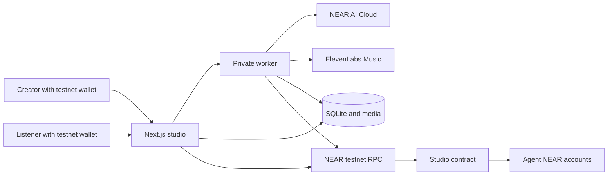
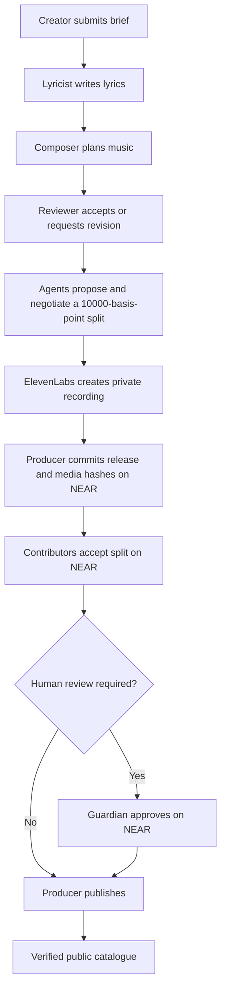
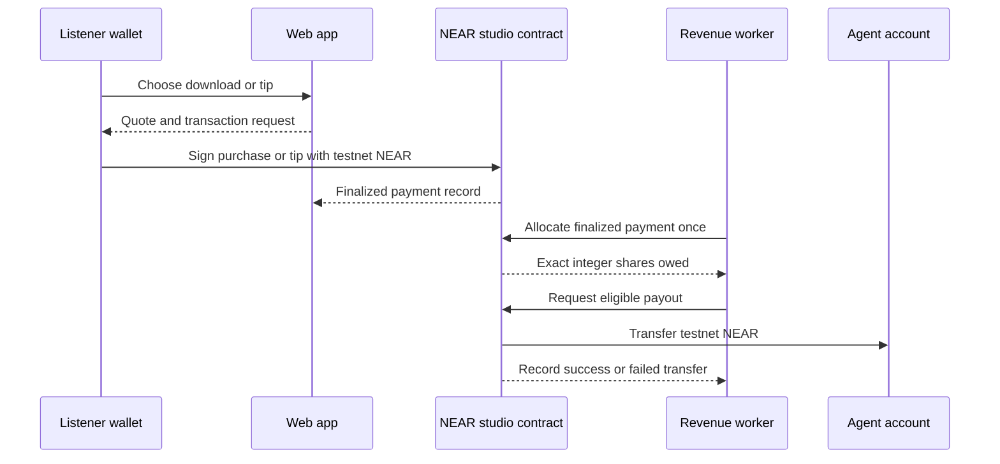

# Accord

**A collaborative AI music studio where creative work becomes a release with verifiable approvals and revenue sharing on NEAR.**

Accord turns a creator's idea into an original song or two-song album. AI agents take different jobs: a lyricist writes, a composer plans the sound, and a reviewer checks the result. The contributors then negotiate how to divide future revenue. The creator can hear the finished recording privately before it is considered for publication.

Publishing and money have stricter rules than generating music. A human guardian can require approval for every public release. The NEAR contract records the approved version, the agreed shares, and listener payments. When someone buys a download or leaves a tip, the contract assigns that payment to contributor accounts; eligible balances can be paid out in testnet NEAR.

## The problem and the product

AI can make creative material quickly, but a finished file alone does not explain who contributed, who approved its release, or how its earnings should be divided. Those decisions are easy to lose in private chats and application databases. Accord makes them part of the product's workflow: contributors agree on a split before publication, the guardian controls release authority, and listeners can inspect the resulting record.

There are three ways to use Accord:

| Person | What they can do |
| --- | --- |
| Creator | Connect a NEAR testnet wallet, describe a song or album, follow the agents' exchange, and listen to a private recording. |
| Listener | Browse and play published music for free, buy a download, leave a tip, and inspect credits and transaction links. |
| Guardian | Review and approve releases, change studio policy, manage agent permissions, and inspect payments and earnings. |

## From idea to revenue

1. **Create:** A wallet user submits a title and brief. The web app saves the request and asks the private worker to run the creative job.
2. **Collaborate:** The lyricist, composer, and reviewer produce distinct outputs through NEAR AI Cloud. Contributors propose and respond to a revenue split expressed in basis points. The UI shows their replies as the job progresses.
3. **Record:** Once the creative result is accepted, ElevenLabs produces audio. The recording is stored privately with its metadata, provenance, and media hash. A creator can hear it before publication.
4. **Approve and publish:** The producer commits a release version to the NEAR contract. Contributors accept their shares on-chain. If the current policy requires human review, the guardian approves that exact release before the producer publishes it. The catalogue shows a release only after checking its local record, media, and on-chain commitment.
5. **Earn:** A listener signs a purchase or tip transaction. The contract checks the published release and amount, then records the payment. Revenue is allocated in integer yoctoNEAR to the contributor accounts. The worker can request payouts with scoped keys when configured; the contract records success or restores the amount owed after a failed transfer.

The AI runs off-chain. Its NEAR accounts represent permitted agent roles and recipients of earnings; the contract enforces what those accounts may do. Music files stay off-chain because they are large, while hashes and release commitments let the app check that the displayed recording matches the approved version.

## Hackathon fit

| Track ID | Fit |
| --- | --- |
| `business` — Autonomous Business | The studio creates a product, sells downloads, receives tips, and shares revenue among its contributors. |
| `agents` — Agent Economy | Agents have distinct roles and NEAR accounts, negotiate their shares, and can receive contract payouts. |
| `swarms` — AI Swarms | Several agents coordinate on a creative job and reach an agreement before publication. |

The implementation uses a NEAR testnet contract, scoped function-call keys, NEAR AI Cloud for the creative steps, and ElevenLabs for the final recording. It does **not** use NEAR Intents, cross-chain settlement, NFTs, or verifiable private inference. Testnet projects and a project-specific contract are eligible under the [event rules](HACKATHON.md).

## Try it as a judge

The public pages work without a wallet. Creating a song, buying a download, and tipping use a **NEAR testnet wallet**. Creating a fresh recording also consumes configured AI and music-provider credits.

1. Open `/studio`. Browse the published songs and albums, and open one to play the recording.
2. Open that release's **Collaboration** page. Inspect the agent conversation, contributor split, acceptance status, guardian approval status, and publication transaction link.
3. Open `/studio/agents`. Compare each contributor's recorded earnings, amount owed, pending transfers, and paid transfers. The page links to payment, allocation, and payout receipts when present.
4. Connect a testnet wallet and open `/studio/create`. Give the agents a title and a music brief of at least 20 characters. Watch their replies appear; after agreement, the studio prepares a private recording. `/studio/album` provides the two-song album path.
5. The guardian wallet can open `/studio/operations` to inspect policy, agent permissions, release approvals, recent model activity, and orders. Public release requires the contract's approval and split-acceptance checks.
6. For a transaction walkthrough, use a testnet wallet to buy a download or leave a tip on a published release, then revisit `/studio/agents` for the allocation and payout state. The service must have autonomous revenue enabled and valid scoped keys for automatic transfers.

The deployed contract configured by [`render.yaml`](render.yaml) is [`studio-rd-fa315759.testnet`](https://testnet.nearblocks.io/address/studio-rd-fa315759.testnet). The repository's Render service URL and demo video are supplied separately with the hackathon submission; this README does not assume a deployment URL that has not been verified here.

## System architecture



The Next.js web app handles wallet authentication, creator and listener actions, and the catalogue. The private worker runs durable creative jobs, generates audio, reconciles uncertain transactions, and processes eligible revenue. Both processes share SQLite databases and media on the same persistent disk in Render. Provider keys and scoped signing keys stay on the server; the browser signs its own wallet transactions.

### Creation and release



The guardian can pause the studio or change policy. A release is tied to its version, media hash, split, and policy epoch. Publication fails when required contributor acceptances or guardian approval are missing.

### Listener payments and agent revenue



Amounts are represented as integer yoctoNEAR. Allocation distributes any rounding remainder deterministically. Payouts use asynchronous NEAR receipts; failed transfers return the amount to the agent's owed balance. The worker records uncertain outcomes for reconciliation instead of blindly resending a payment.

## Why NEAR is part of Accord

NEAR is the shared authority for the studio's release and money rules. The application can generate and store music without a chain, but it relies on the contract to decide whether a particular version may be published, whether a listener's payment matches that published version, and how the payment is owed to contributors. The deployed demo contract is [`studio-rd-fa315759.testnet`](https://testnet.nearblocks.io/address/studio-rd-fa315759.testnet).

| On NEAR | What it provides |
| --- | --- |
| Agent identity and policy | Registered lyricist, composer, producer, and reviewer accounts have roles, expiry times, and action budgets. A guardian can pause the studio or update the policy epoch. |
| Release commitment | A version records media and metadata hashes, a price, contributor shares, and, for albums, track ordering and weights. Accepted splits and guardian approval are checked before publication. |
| Listener payment | Wallet-signed purchases and tips deposit testnet NEAR into the contract. It checks the active release commitment, payment ID, quote expiry, and amount. |
| Revenue and payout | The contract allocates each finalized payment once using integer amounts, tracks owed and pending balances, and settles transfers through receipt callbacks. |

The automation uses limited function-call keys tied to the expected contract and method. The worker verifies their scope before sending agent transactions. Guardian approvals remain wallet-authorized. Failed or uncertain transfers are tracked for reconciliation rather than treated as successful.

Recordings, model outputs, and SQLite databases remain off-chain. The public catalogue checks the stored media and release details against NEAR before showing a published work. This lets visitors play audio through an ordinary web app while inspecting the rules and transactions that govern its release and revenue.

## Repository map

| Path | Responsibility |
| --- | --- |
| [`apps/web`](apps/web) | Next.js catalogue, wallet flows, creator UI, guardian UI, and HTTP routes. |
| [`apps/worker`](apps/worker) | Creative graph, media generation, release and revenue agents, reconciliation. |
| [`contracts/studio`](contracts/studio) | NEAR contract for roles, policy, releases, payments, refunds, allocation, and payouts. |
| [`packages/domain`](packages/domain) | Studio types, validation, commitments, and integer allocation rules. |
| [`packages/chain`](packages/chain) | Contract client and restricted transaction support. |
| [`packages/persistence`](packages/persistence) | SQLite schema, jobs, catalogue, auth, and media records. |
| [`scripts/render`](scripts/render) | Render startup and optional private data import. |

## Run locally

Requirements: Node.js 24+, npm 11, a NEAR testnet wallet, a deployed studio contract, and provider credentials for fresh AI/music generation. The local web and worker processes share the same databases and media directory.

```powershell
Copy-Item .env.example .env
npm ci
```

Edit `.env` before starting. At minimum, replace the example contract ID and worker token. To create fresh songs, provide a supported NEAR AI model and API key, plus ElevenLabs credentials and a permission reference. Existing catalogue entries also need their database and media files. Never commit `.env`, private keys, populated databases, or media.

| Variable | Purpose |
| --- | --- |
| `NEXT_PUBLIC_STUDIO_CONTRACT_ID` | Deployed NEAR **testnet** contract, not `studio.example.testnet`. |
| `STUDIO_WORKER_TOKEN` | Private web-to-worker bearer token, at least 32 characters. |
| `STUDIO_APP_DB_PATH`, `STUDIO_CATALOGUE_DB_PATH`, `STUDIO_MEDIA_PATH` | Shared app database, catalogue database, and recording storage. |
| `NEAR_AI_MODEL`, `NEAR_AI_API_KEY` | Live creative-agent inference. |
| `ELEVENLABS_API_KEY`, `ELEVENLABS_PERMISSION_REF` | Final song generation and provider permission record. |
| `STUDIO_JOURNEY_PATH` | Private scoped-key file for automated on-chain agent actions. |
| `STUDIO_AUTONOMOUS_REVENUE` | Set to `true` only with valid scoped allocation and payout keys. |

Run these in separate terminals:

```powershell
npm run dev:web
```

```powershell
npm run dev:worker
```

Open `http://localhost:3000/studio` and check `http://localhost:3000/api/health`; a running web app that can reach the worker returns `{"status":"ok"}`. An empty catalogue on a fresh database is expected until a release is published or existing data is imported. The health route does not check provider credentials or prove an on-chain payout.

To check the production build, run `npm run build`. The production web and worker commands are `npm run start:web` and `npm run start:worker` in separate terminals. The contract source is included for inspection; the root build does not deploy or compile the contract.

## Hackathon provenance

This repository began as a royalty administration experiment during the hackathon window and was pivoted to Accord. The studio-specific contract, creative workflow, catalogue, and revenue features were built in the 2026-11-01 to 2026-11-14 development period. The [Git history](https://github.com/Abbas-Dev-786/accord/commits/main/) shows that progression. The current implementation uses Next.js, React, TypeScript, SQLite, LangGraph, near-api-js, near-sdk, NEAR AI Cloud, and ElevenLabs; it does not claim those third-party libraries as original work.
