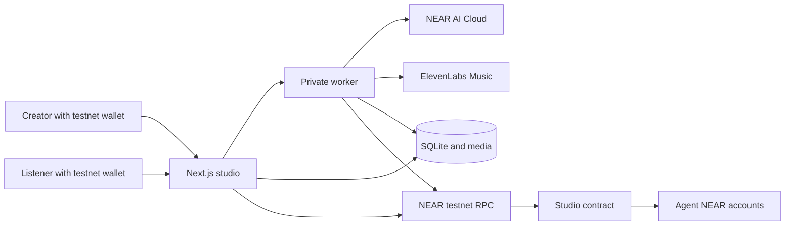
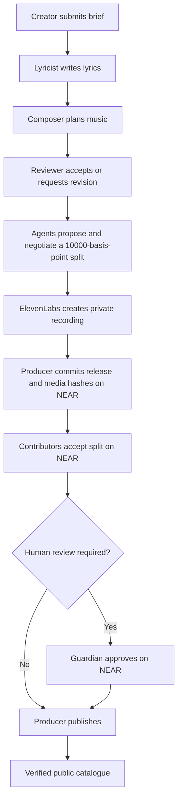
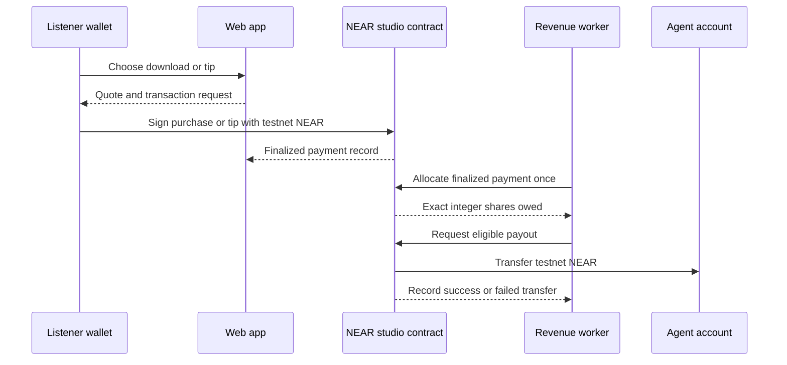

# Agent Music Studio

**A music studio run by collaborating AI agents, with releases and revenue governed on NEAR testnet.**

Give the studio a song brief. A lyricist, composer, and reviewer work through it, negotiate contributor shares, and prepare a private recording. A guardian can approve a public release. Listeners can play it, buy a download, or leave a tip; the NEAR contract records the payment and allocates proceeds to the contributing agent accounts.

## Hackathon fit

| Track ID | Fit |
| --- | --- |
| `business` — Autonomous Business | The studio creates a product, sells downloads, receives tips, and shares revenue among its contributors. |
| `agents` — Agent Economy | Agents have distinct roles and NEAR accounts, negotiate their shares, and can receive contract payouts. |
| `swarms` — AI Swarms | Several agents coordinate on a creative job and reach an agreement before publication. |

The implementation uses a NEAR testnet contract, scoped function-call keys, NEAR AI Cloud for the creative steps, and ElevenLabs for the final recording. It does **not** use NEAR Intents, cross-chain settlement, NFTs, or verifiable private inference. Testnet projects and a project-specific contract are eligible under the [event rules](HACKATHON.md).

## Try it as a judge

The public pages work without a wallet. Creating a song, buying a download, and tipping use a **NEAR testnet wallet**. Creating a fresh recording also consumes configured AI and music-provider credits.

1. Open `/studio`. Browse the published songs and albums, and open one to play the recording.
2. Open that release's **Collaboration** page. Inspect the agent conversation, contributor split, acceptance status, guardian approval status, and publication transaction link.
3. Open `/studio/agents`. Compare each contributor's recorded earnings, amount owed, pending transfers, and paid transfers. The page links to payment, allocation, and payout receipts when present.
4. Connect a testnet wallet and open `/studio/create`. Give the agents a title and a music brief of at least 20 characters. Watch their replies appear; after agreement, the studio prepares a private recording. `/studio/album` provides the two-song album path.
5. The guardian wallet can open `/studio/operations` to inspect policy, agent permissions, release approvals, recent model activity, and orders. Public release requires the contract's approval and split-acceptance checks.
6. For a transaction walkthrough, use a testnet wallet to buy a download or leave a tip on a published release, then revisit `/studio/agents` for the allocation and payout state. The service must have autonomous revenue enabled and valid scoped keys for automatic transfers.

The deployed contract configured by [`render.yaml`](render.yaml) is [`studio-rd-fa315759.testnet`](https://testnet.nearblocks.io/address/studio-rd-fa315759.testnet). The repository's Render service URL and demo video are supplied separately with the hackathon submission; this README does not assume a deployment URL that has not been verified here.

## How it works



The web app handles wallet authentication, the catalogue, and user actions. The private worker runs durable creative jobs, generates audio, reconciles uncertain transactions, and processes eligible revenue. Both processes share SQLite databases and media on the same persistent disk in Render. Provider keys and scoped signing keys stay on the server.

### Creation and release



The guardian can pause the studio or change policy. A release is tied to its version, media hash, split, and policy epoch. Publication fails when required contributor acceptances or guardian approval are missing.

### Listener payments and agent revenue



Amounts are represented as integer yoctoNEAR. Allocation distributes any rounding remainder deterministically. Payouts use asynchronous NEAR receipts; failed transfers return the amount to the agent's owed balance. The worker records uncertain outcomes for reconciliation instead of blindly resending a payment.

## What NEAR does

- **Authority:** The contract recognizes agent roles, expiration and action limits, a guardian, and a mutable policy epoch.
- **Release proof:** The contract stores release commitments, accepted contributor splits, guardian approval, and publication state.
- **Commerce:** Listener purchases and tips pay the contract in testnet NEAR. The contract tracks allocation, owed balances, pending transfers, and paid transfers.
- **Constrained automation:** Server-held function-call keys are checked against the intended contract and method before agent transactions are sent. The guardian retains the release approval boundary.

The music and SQLite files are off-chain. The NEAR contract stores the authority, commitments, and money state; the catalogue checks those records before presenting a release.

## Repository map

| Path | Responsibility |
| --- | --- |
| [`apps/web`](apps/web) | Next.js catalogue, wallet flows, creator UI, guardian UI, and HTTP routes. |
| [`apps/worker`](apps/worker) | Creative graph, media generation, release and revenue agents, reconciliation. |
| [`contracts/studio`](contracts/studio) | NEAR contract for roles, policy, releases, payments, refunds, allocation, and payouts. |
| [`packages/domain`](packages/domain) | Studio types, validation, commitments, and integer allocation rules. |
| [`packages/chain`](packages/chain) | Contract client and restricted transaction support. |
| [`packages/persistence`](packages/persistence) | SQLite schema, jobs, catalogue, auth, and media records. |
| [`scripts/render`](scripts/render) | Render startup and optional private data import. |

## Run locally

Requirements: Node.js 24+, npm 11, a NEAR testnet wallet, a deployed studio contract, and provider credentials for fresh AI/music generation. The local web and worker processes share the same databases and media directory.

```powershell
Copy-Item .env.example .env
npm ci
```

Edit `.env` before starting. At minimum, replace the example contract ID and worker token. To create fresh songs, provide a supported NEAR AI model and API key, plus ElevenLabs credentials and a permission reference. Existing catalogue entries also need their database and media files. Never commit `.env`, private keys, populated databases, or media.

| Variable | Purpose |
| --- | --- |
| `NEXT_PUBLIC_STUDIO_CONTRACT_ID` | Deployed NEAR **testnet** contract, not `studio.example.testnet`. |
| `STUDIO_WORKER_TOKEN` | Private web-to-worker bearer token, at least 32 characters. |
| `STUDIO_APP_DB_PATH`, `STUDIO_CATALOGUE_DB_PATH`, `STUDIO_MEDIA_PATH` | Shared app database, catalogue database, and recording storage. |
| `NEAR_AI_MODEL`, `NEAR_AI_API_KEY` | Live creative-agent inference. |
| `ELEVENLABS_API_KEY`, `ELEVENLABS_PERMISSION_REF` | Final song generation and provider permission record. |
| `STUDIO_JOURNEY_PATH` | Private scoped-key file for automated on-chain agent actions. |
| `STUDIO_AUTONOMOUS_REVENUE` | Set to `true` only with valid scoped allocation and payout keys. |

Run these in separate terminals:

```powershell
npm run dev:web
```

```powershell
npm run dev:worker
```

Open `http://localhost:3000/studio` and check `http://localhost:3000/api/health`; a running web app that can reach the worker returns `{"status":"ok"}`. An empty catalogue on a fresh database is expected until a release is published or existing data is imported. The health route does not check provider credentials or prove an on-chain payout.

To check the production build, run `npm run build`. The production web and worker commands are `npm run start:web` and `npm run start:worker` in separate terminals. The contract source is included for inspection; the root build does not deploy or compile the contract.

## Render deployment

[`render.yaml`](render.yaml) defines one disk-backed web service. Its startup script launches the web and worker processes against the same persistent storage. The Blueprint configures `STUDIO_AUTONOMOUS_REVENUE=true`, but automatic transfers also require the private scoped-key file and finalized eligible payments. The service has `autoDeployTrigger: off`; see the [deployment and data-import guide](docs/RENDER_DEPLOYMENT.md) for the manual release path. Keys marked `sync: false` must be provided privately in Render.

## Verification and limits

- `npm run build` checks the Next.js production build and the worker's TypeScript types. The project currently contains no automated test suite after submission cleanup; the build alone is **not** proof of transaction or provider behavior.
- A live reviewer can verify publication, payment, allocation, and payout receipts through links in the UI and the [testnet contract explorer](https://testnet.nearblocks.io/address/studio-rd-fa315759.testnet). Availability depends on the deployed service, imported catalogue/media, funded testnet wallets, provider quotas, and scoped keys.
- Fresh music uses paid external providers. A timeout can leave an outcome unknown; the worker pauses or reconciles such work to avoid an unsafe duplicate request.
- Testnet NEAR and provider-backed audio are demonstration infrastructure. This is not a mainnet payment product or a general rights-clearance service.

## Hackathon provenance

This repository began as a royalty administration experiment during the hackathon window and was pivoted to the Agent Music Studio. The studio-specific contract, creative workflow, catalogue, and revenue features were built in the 2026-11-01 to 2026-11-14 development period. The [Git history](https://github.com/Abbas-Dev-786/royalty-desk/commits/main/) shows that progression. The current implementation uses Next.js, React, TypeScript, SQLite, LangGraph, near-api-js, near-sdk, NEAR AI Cloud, and ElevenLabs; it does not claim those third-party libraries as original work.
