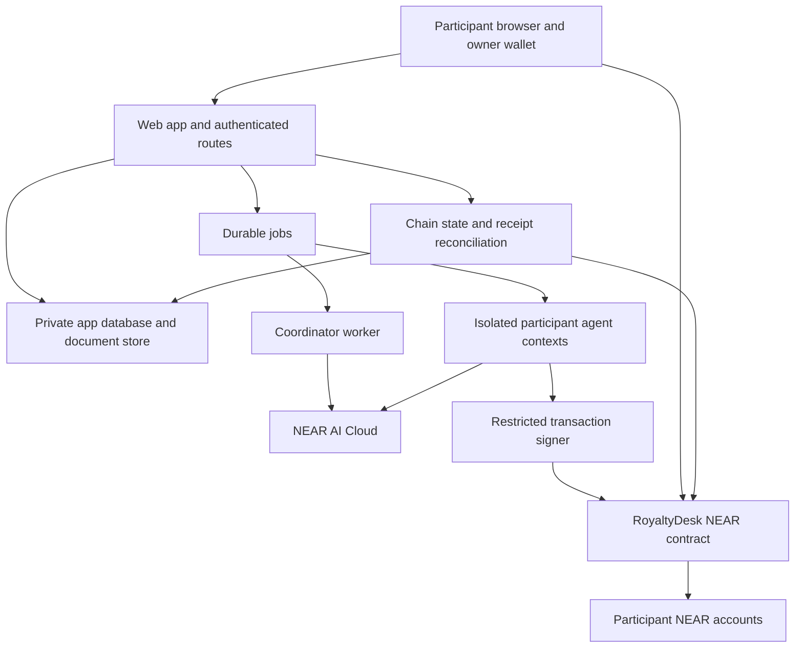
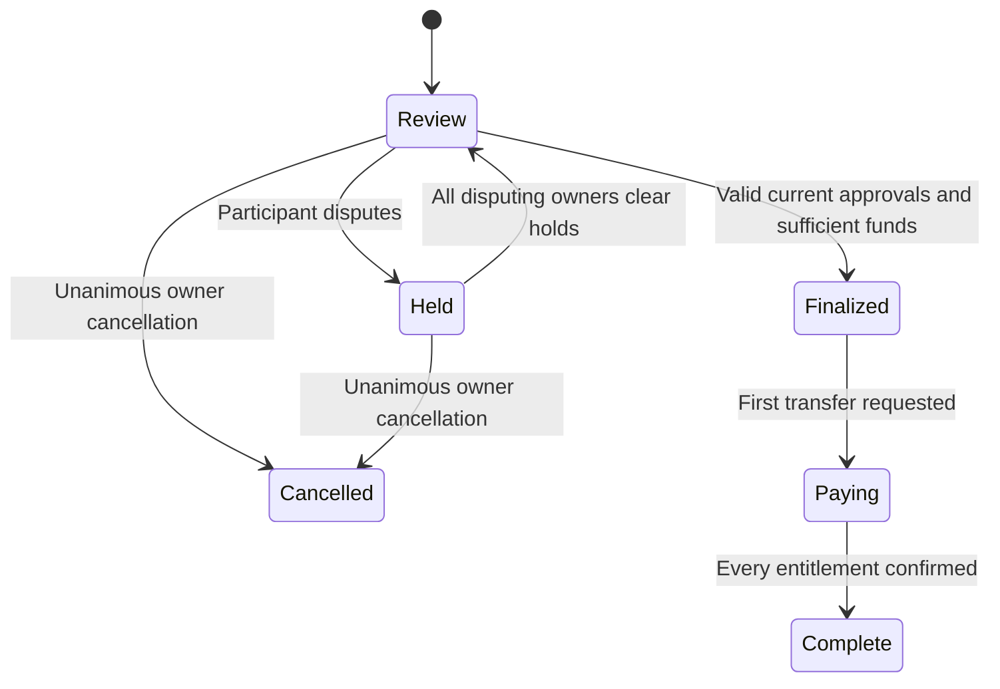

# RoyaltyDesk — Technical Design

Status: proposed implementation baseline v0.1. Date: 2026-11-07. Contract interfaces below are application designs, not existing NEAR APIs or deployed code.

Related: [PRD](PRD.md), [current scope](CURRENT_SCOPE.md), [features](FEATURES.md), [future scope](FUTURE_SCOPE.md).

## 1. Decisions

| Concern | Decision | Reason |
| --- | --- | --- |
| Web application | TypeScript, React, Next.js App Router | One application for participant UI and authenticated HTTP endpoints |
| Agent execution | Separate persistent TypeScript worker | Long agent runs must survive HTTP request completion and worker restart |
| Persistence | SQLite and a private file directory on a single persistent host for MVP | No external database dependency; one host owns database/file writes |
| Chain | NEAR testnet | Real contract execution without mainnet funds |
| Contract | Rust with near-sdk-rs; one bounded application contract | Keep agreement, mandate, and reserve checks in one authoritative state transition |
| Model | NEAR AI Cloud gateway, server-side calls | Actual NEAR ecosystem inference for private commercial data |
| Wallet/client package | Selection pending compatibility validation against current NEAR docs | Must support owner signing, authentication, and separate agent setup |
| Settlement asset | Native testnet NEAR only | Avoid token registration and stablecoin integration complexity in required path |
| Numbers | Integer yoctoNEAR; integer basis points | No floating-point money calculations |
| Hosting | Persistent Node-capable host with worker and durable volume; local fallback | Ephemeral serverless filesystems are incompatible with this SQLite/file design |
| Versions | Pin tested package/toolchain versions and lockfiles at scaffold time | No invented version compatibility promises |

SQLite is an implementation choice for the prototype, not a production scaling commitment. No database schema or runtime dependency is being installed by this document. If hosting requires separate services/replicas, redesign persistence before deployment.

Implementation refinements and initial numeric bounds are recorded in [Decision 0001](decisions/0001-implementation-baseline.md). Canonical commitment bytes are specified in [Decision 0002](decisions/0002-canonical-encoding.md). These records refine caller, funder, cancellation, mandate, persistence, and hashing behavior without expanding the current product scope.

## 2. Architecture and authority

Chain is authoritative for approved agreement rules, mandates, approvals, disputes, balances, entitlements, and transfer state. Database is authoritative for private preferences, uploaded files, drafts, jobs, and UI projections. A database status cannot make an unapproved chain settlement payable.

Models produce proposed actions. A validated tool layer enforces local policy before a restricted signer submits permitted calls. The contract independently enforces economic permissions. Keys never enter prompts or model tool responses.

NEAR AI Cloud inference is not an agent-hosting enclave for our whole application. The app operator can access material processed by its own backend unless a later client-encrypted design removes that access. Do not claim end-to-end confidentiality from the application operator.

## 3. Identity and authorization

### Owner identities

Each user connects an existing NEAR testnet account. Authentication uses a wallet-supported signed message challenge or a verified challenge transaction, subject to wallet compatibility validation. The challenge includes application domain, network ID, nonce, issued time, and expiry. The server checks account/key authority, signature or finalized transaction, and one-time use. Sessions use secure HttpOnly cookies, with same-origin/CSRF protection for mutations.

Check authentication and release membership at each server data-access boundary, not just in navigation. Return minimal DTOs. Files are fetched through authorized routes; no public bucket links or predictable static paths.

### Agent identities

Use a separate NEAR agent account for each participant. Owner-to-agent mapping is an explicit contract mandate, not inferred from account naming. The worker holds only a function-call key restricted to the RoyaltyDesk contract's agent methods. It must not hold an owner's full-access key.

Demo agent-account provisioning requires validated wallet support for account creation and restricted keys. Recovery/full-access credentials remain outside the worker, owned by the participant or explicitly disclosed demo administrator. The account model retains a recovery path and does not assume deleting all full-access keys is safe.

Separate accounts let the contract authorize agent calls by `predecessor_account_id`; owner-only methods require the registered owner predecessor. Do not use a caller-supplied `owner_id` or original signer as a substitute for immediate-caller authorization. Relay/meta-transaction support is excluded from the MVP path.

Mandate fields: owner account, agent account, release ID, agreement version/hash, allowed actions, maximum gross settlement amount, expiry timestamp, active flag, and monotonically increasing epoch. Revoking or replacing increments epoch. Chain approvals made by an agent store that epoch; finalization checks it is still active, in scope, and unexpired. Human approvals are recorded separately.

Function-call keys cannot attach NEAR; agent methods accept zero deposit. Owners fund reserves and storage separately. Gas allowance is not a substitute for the contract's amount cap.

## 4. Agreement design

Structured rules include release ID, recording identifier, sorted owner accounts, shares in basis points, optional fixed recoupment cap and beneficiary, effective starting period, template version, and document hash. Destination for each participant is their owner account in the native MVP. A separate arbitrary withdrawal address is not supported.

Max five participants; shares sum to 10,000; duplicates and invalid accounts are rejected. The recoupment beneficiary must be a participant. The recoupment is one release-level fixed advance, not a new deductible amount every period.

Canonical JSON format must be specified in code and covered by shared fixtures: sorted object keys, stable account ordering, no ambiguous numbers, amount strings, UTF-8 encoding, and fixed schema version. Commit with SHA-256. Domain-bind the approval to application, network, contract ID, release ID, and agreement version so another environment cannot reuse it. Both rendered document hash and structured-rules hash are included in the approved digest.

State: `DRAFT -> FROZEN -> ACTIVE`; frozen offers may be superseded without becoming active. Each owner approves the frozen digest in a wallet transaction. Agents cannot invoke human-approval methods. A changed document/rule creates a new version.

Amendment activation requires unanimous owner approval and no open settlement for that release. Carry forward consumed recoupment, rejecting a new cap below what was already allocated. Do not allow changing recoupment beneficiary after any recoupment has been allocated in MVP. Existing finalized entitlements remain immutable. Old mandates do not apply to the new version.

## 5. Statement ingestion and trust

### Supported CSV v1

| Column | Rule |
| --- | --- |
| statement_id | Bounded source statement identifier |
| line_id | Unique within the imported statement |
| period | YYYY-MM, one value per import |
| recording_id | Exact registered recording identifier |
| platform | Bounded label; informational, not authentication |
| row_type | `revenue` or `deduction_claim` |
| amount | Nonnegative base-10 NEAR string, at most 24 fractional digits |
| currency | Exactly `NEAR` in this release |
| deduction_code | Empty for revenue; approved recoupment identifier or unsupported claim label |
| evidence_ref | Optional bounded reference to a supplied private document |

File limit 1 MiB, row limit 100. Reject wrong headers, duplicate IDs, invalid amounts, inconsistent recording/period, control characters, and overflow. Escape spreadsheet formula characters in exports. Parse with a maintained CSV parser chosen at implementation, not ad hoc line splitting.

Compute raw-file hash and normalized semantic hash. Unique payable identity is `(release_id, period)`; filenames, statement IDs, and changed whitespace cannot bypass it. Corrections create revisions under the same identity. Retain originals and provenance rather than overwriting them.

Revenue rows sum to gross reported funds. Deduction claims are proposed explanations only; they do not independently debit the reserve. The only allowed deduction is the contract-computed remaining fixed recoupment. Invalid claims block approval. The corrected statement must match the applicable deterministic calculation.

The canonical example is synthetic and NEAR-denominated; it exercises payment rules without pretending to convert a dollar royalty statement. Real foreign-currency statements are not accepted by this adapter. Source truth is asserted by the uploader and reviewed by participants, not obtained from Spotify stream counts.

## 6. Settlement and dispute states

There is one live settlement per release, and one permanent identity per release-period. This serialization prevents two periods concurrently consuming the same recoupment balance. New periods must be later than the last finalized period. Retroactive corrections are deferred.

Funding is an independent ledger value rather than a state: a review/held period may have a deposit. A new revision stays in the same identity, changes its digest and clears approvals, but does not clear disputes. No elapsed-time rule silently approves terms or releases money.

Settlement commitment includes release, period, agreement version, revision, normalized statement hash, gross integer amount, deduction evidence hash, and computed-allocation preview hash. Contract recomputes its own values at finalization; preview hash is useful for user review, not authoritative arithmetic.

Every required participant must approve the exact current revision, either directly as owner or through a current mandate. An owner supersedes their own agent approval. One account cannot fill another participant's slot. When an agent mandate is revoked, its unfinalized approval is unusable even if the database still displays it; UI must reflect that.

Revocation prevents future authorization, not reversal of finalized entitlements. Execution of immutable entitlements remains possible after agents go offline. Disputes after finalization cannot undo paid funds; future production correction handling is separate.

## 7. Contract interface sketch

All methods below need bounded input sizes and explicit errors. Owner/agent roles are contract checks, independent of the interface.

| Method | Authorized caller | Effect |
| --- | --- | --- |
| `create_release` | Creator owner | Create bounded release and invitation set |
| `accept_membership` | Invited owner | Confirm participation |
| `freeze_agreement` | Release administrator | Store immutable proposal with structured rules and hashes |
| `approve_agreement` | Listed owner only | Record approval of exact proposal; activate on final valid approval |
| `set_mandate` / `revoke_mandate` | Participant owner | Set scoped delegation; increment epoch |
| `open_settlement` / `revise_settlement` | Administrator | Commit statement identity/revision, clear approvals; preserve disputes |
| `approve_settlement` | Participant owner or their authorized agent | Record exact digest and authority source |
| `dispute_settlement` | Participant owner or authorized agent | Set that participant's hold with non-sensitive reason commitment |
| `clear_dispute` | Disputing owner only | Clear their hold on reviewed revision |
| `fund_settlement` | Registered funder | Attach NEAR to earmarked reserve |
| `finalize_settlement` | Any caller | Validate all conditions; allocate entitlements once |
| `execute_payout` | Any caller | Send one finalized entitlement to immutable owner account |
| `on_payout_complete` | Contract-only callback | Record outcome for matching transfer attempt |
| `approve_cancellation` | All participant owners individually | Before finalization, unanimously cancel; make remaining deposit refundable |
| `withdraw_refundable` | Funder | Refund cancelled/excess amount using pending-transfer accounting |
| Read methods | Public | Non-sensitive contract state and readiness |

Private callbacks use predecessor equality to the contract and a matching stored attempt ID. No administrator method may override participant approval, arbitrarily sweep royalty reserves, or replace finalized destinations. Contract deployment-key custody remains an explicitly documented external trust assumption; an upgradeable account is not immutable merely because the ABI lacks a sweep method.

Storage is sponsored from a separate operator budget for bounded demo state. Funding transfers must not silently pay for agreement storage. Bound open records and preflight storage/gas headroom; fail safely when capacity is exhausted.

## 8. Accounting and rounding

Let `G` be gross amount, `R` remaining approved recoupment, and `C = min(G, R)`. Set distributable `D = G - C`. For participant `i`, provisional share is `floor(D * basis_points_i / 10000)`. Use checked wide multiplication or quotient/remainder decomposition to avoid u128 overflow.

Distribute leftover atomic units by largest fractional remainder, with lexicographic owner account as a stable tie-breaker. Add `C` to the approved recoupment beneficiary's entitlement, consolidating payments to a single entitlement per account. Therefore sum(entitlements) equals `G` exactly.

At finalization decrement remaining recoupment by `C`, move `G` from available period funds into entitlements, and mark the release-period consumed atomically in contract state. Payout attempts never recalculate or decrement recoupment. Excess `deposit - G` is separately refundable after finalization. Cancellation before finalization leaves recoupment unchanged.

Accounting invariant per period:

`total_deposited = unallocated + refundable + unpaid_entitlements + in_flight_transfers + successful_payouts + successful_refunds`

These are mutually exclusive ledger categories. Gas and storage sponsorship are separate from this principal ledger. The contract must maintain enough backing for all nonterminal obligations plus storage needs; accounting is not simply its raw account balance.

### Transfer safety

Entitlement state is `AVAILABLE -> PENDING(attempt_id) -> PAID` or `PENDING -> AVAILABLE` only upon confirmed transfer failure. Set pending before creating a Promise. Callback is private and idempotent; it verifies identity and current attempt. A stale callback cannot restore or consume a different attempt.

A successfully submitted transaction is not a completed transfer. If a transfer succeeds but its callback fails, keep funds unavailable for another payment and show reconciliation required. Do not add an admin "mark failed" escape hatch. MVP documents manual investigation and treats this as a liveness failure; any later repair mechanism requires verifiable receipt evidence and separate design. Allocate callback gas and keep callback work minimal to avoid this condition.

Funder refunds use the same pending/success/failure rules. No timeout automatically refunds a disputed or in-flight balance. Unanimous pre-finalization cancellation provides a defined exit; refusal to cooperate can leave funds held and is an acknowledged limitation.

## 9. Agent orchestration

Use explicit jobs rather than an open-ended autonomous loop:

`queued -> leased -> running -> awaiting_human | succeeded | failed`

Persist each job's release, participant, input digest, phase, attempts, model, allowed tools, result, and optional chain transaction hash. Lease expiry allows recovery of computation; it does not authorize resubmitting a financial action. Reconcile any previously submitted transaction before retrying.

Allowed model outputs: `propose_terms`, `counter_terms`, `request_evidence`, `recommend_approval`, `raise_objection`, or `needs_human`. Tool dispatcher translates approval recommendations into contract calls only after validating schemas, current mandate, exact input digest, and deterministic financial checks.

Coordinator tools cannot access personal preferences or participant signing credentials. Agent-specific tools accept identities from server context, not model arguments. Treat uploaded text and other agents' messages as untrusted evidence, never higher-priority instructions. No shell, arbitrary URLs, or arbitrary signing payload tool is exposed.

Initial limits: three negotiation rounds; two attempts per model call; explicit configured per-job token/cost ceilings; zero automatic retries for ambiguous chain outcomes. On invalid financial inference, show a validation error and request correction or human review. Preserve short factual rationale and evidence IDs; do not persist chain-of-thought.

## 10. App data and HTTP boundaries

Conceptual records, to be implemented with migrations:

| Record | Main fields / constraints |
| --- | --- |
| User | Unique NEAR network/account, display name |
| Session challenge | Nonce, domain, network, expiry, consumed timestamp |
| ReleaseMembership | Release, owner, invitation acceptance, role |
| AgentProfile | Owner, private encrypted instructions, agent identity, configuration |
| Document | Private storage key, content hash, type, owner/access scope, size |
| AgreementDraft | Release, version, canonical rules, document commitment, chain reference |
| StatementImport | Release/period, raw and normalized hash, provenance, validation result |
| SettlementProjection | Chain identity/revision and last-confirmed state; never source of monetary truth |
| AgentJob | Unique logical job key, lease, phase, attempts, input digest |
| AgentAction | Job, actor, validated proposal, rationale, evidence IDs, chain transaction |
| ChainOperation | Unique logical operation, submitted hash, receipt status, reconciliation timestamp |

Private preferences and documents should be encrypted at rest using an application secret outside the database. This protects stored copies, not against the app operator holding the decryption key. Use private filesystem permissions, size limits, retention controls, and redaction in error logs.

Proposed route groups: `/api/auth/challenge`, `/api/auth/verify`, `/api/releases`, `/api/releases/:id/invitations`, `/api/releases/:id/agents/me`, `/api/releases/:id/negotiations`, `/api/releases/:id/agreements`, `/api/releases/:id/statements`, `/api/releases/:id/settlements`, `/api/jobs/:id`, and `/api/chain/operations/:id`.

Each mutation verifies session, membership, role and input schema. Owner-wallet actions return transaction requests for wallet approval; the server does not impersonate owner signatures. Long-running requests enqueue jobs and return IDs for polling. Add idempotency keys to job creation and imports. Browser refresh does not create another job or transfer.

## 11. Conditional integration boundaries

### NEAR Intents

Separate adapter and environment. Require a supported route, bounded amount, recipient-authorized destination, quote expiry, intended refund recipient, and evidence linking the quote's deposit address to these terms. The native MVP's fixed-recipient payout must not become an unrestricted "send to backend-provided address" method.

The authorization-binding design remains unresolved: it must specify how the NEAR contract verifies the binding or which signer/adapter is trusted. An API quote fetched by a server is not automatically authenticated on-chain. Until that requirement is satisfied, this integration supports a labeled preview rather than contract-enforced cross-chain payouts.

Track `quoted`, `authorized`, `deposit_pending`, `processing`, `success`, `refunded`, `failed`, and `unknown`. Neither a submitted deposit nor an API timeout proves destination payment failure. Keep obligations reserved until final reconciliation. A mainnet pilot uses independent real mainnet funds and explicit user authorization.

### NEAR AI verification

Use current documented gateway flow. Verify available endpoint attestation and response integrity before displaying verification evidence. A missing signature means response integrity is not verified. Do not describe an ordinary API response as attested without checking it.

### Spotify

Catalogue identity only if app access permits. Artist analytics may be authorized exports; reported earnings come from distributor/label statements. No runtime scraping of private dashboards and no assumed royalty payout endpoint.

## 12. Security and correctness checks

| Test | Expected outcome |
| --- | --- |
| Shares do not sum to 10,000 | Agreement rejected |
| Agent tries to approve agreement | Caller rejected |
| Participant A approves for B | Caller rejected |
| Old digest after revision | Approval rejected / old approval unusable |
| Mandate expired, revoked or wrong release | Agent action rejected |
| Mandate revoked after approval but before finalization | Finalization rejected until valid reapproval |
| Active participant dispute | Finalization rejected |
| Unsupported expense claim | Approval workflow blocked; no arbitrary debit |
| Another period attempts concurrent recoupment | Serialization rejects new live settlement |
| Insufficient reserve | Finalization rejected |
| Odd atomic-unit allocation | Deterministic rounding; exact conservation |
| Duplicate/reformatted statement for same period | Revision or existing record, not another settlement |
| Concurrent payout triggers | Only one pending transfer |
| Spoofed/stale callback | Rejected or harmless idempotent no-op |
| Explicit transfer failure | Entitlement remains recoverable |
| Unknown callback outcome | Funds stay pending; no blind retry |
| Worker restart after transaction submission | Reconcile existing hash before any retry |
| Malicious invoice asks agent to change wallet | No permitted tool or contract authority |
| Cross-user document access | Denied before content leaves server |
| Contract account storage pressure | Fail without spending earmarked principal |

Verification coverage includes Rust unit tests for transitions and arithmetic, NEAR sandbox/integration tests for actual Promise behavior and permissions, and a browser-level end-to-end flow for user approval and status visibility. Unit mocks alone cannot establish asynchronous transfer correctness.

## 13. Implementation layout and configuration

Proposed structure: `apps/web`, `apps/worker`, `contracts/royaltydesk`, `packages/domain`, `packages/chain`, `fixtures`, `tests`, and `docs`. Domain package owns amount parsing, canonicalization, schemas, and shared vectors. Contract recomputes financial rules independently.

Configuration includes network, RPC URL, contract account, NEAR AI base URL/model/API key, session/encryption secrets, database/file paths, worker limits, and agent keystore path. Only public identifiers reach browser configuration. Keep `.env.example` as placeholders; never commit populated keys, funding-account secrets, private statements, or personal submission payloads.

Technical dependencies requiring compatibility validation include wallet authentication/signing, agent account/key setup, zero-deposit delegated calls, testnet contract deployment, private NEAR AI inference, worker persistence, and target-host support for Rust test tooling.

## 14. Sources and limitations

- [NEAR account permissions](https://docs.near.org/protocol/accounts-contracts/access-keys)
- [NEAR security checklist](https://docs.near.org/smart-contracts/security/checklist)
- [Rust SDK and asynchronous/private methods](https://github.com/near/near-sdk-rs)
- [Next.js authentication and authorization](https://nextjs.org/docs/app/guides/authentication)
- [NEAR AI private inference](https://docs.near.ai/cloud/private-inference)
- [Intents swap types](https://docs.near-intents.org/integration/distribution-channels/1click-api/swap-types)
- [Spotify track metadata](https://developer.spotify.com/documentation/web-api/reference/get-track)

Current docs were consulted through Context7 during planning. Exact API syntax, model availability, wallet compatibility, deployment settings, and package versions must be verified during implementation. This document specifies a proposed system; it is not evidence of working integrations or an audit.
